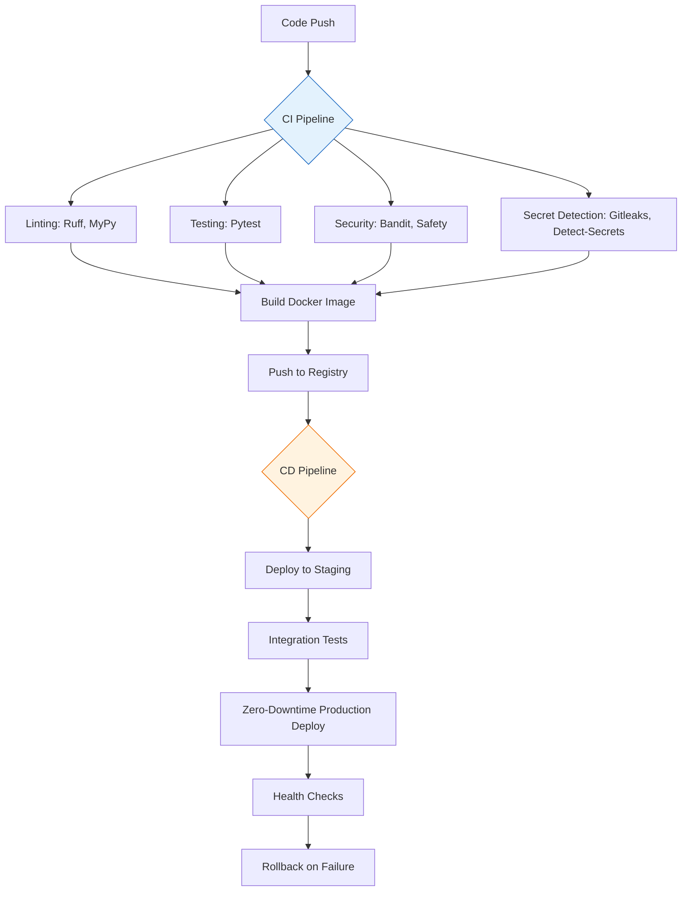

> **Current implementation (October 2026):** The supported flow is a web setup wizard
> launched with `bash start.sh` on the target 64-bit Raspberry Pi. See README.md
> for installation, SSH access, runtime credential storage, and validation limits.
> The launcher starts the setup page only; **Set up Hermes** saves configuration
> and deploys the container. Telegram, Discord and Slack can be configured in
> the wizard. The **Start** control uses existing runtime configuration. Docker's
> `unless-stopped` policy handles container startup after reboot when the Docker
> service is enabled and the container has not been deliberately stopped/removed.
> The historical checkboxes below are not a verified completion report. TUI,
> CI/CD, automatic rollback, volume backups, and zero-downtime claims below do
> not describe the supported wizard. Pi hardware verification remains pending.

# Implementation Plan: Docker-Based Hermes Agent Setup Project

## Executive Summary
This project creates a portable, credential-free setup for deploying the Hermes agent (Nous Research personal assistant) using Docker and Python (managed with uv). It includes a Terminal User Interface (TUI) for easy management, CI/CD pipelines with zero-downtime deployments, and robust secrets management. The implementation follows modern DevOps practices with idempotent scripts, cross-platform support, and maintains agent state persistence across deployments.

## Project Structure
```
hermes-setup/
├── .github/
│   └── workflows/
│       ├── ci.yml          # lint, test, build, security scans
│       └── cd.yml          # zero-downtime deploy with rollback
├── src/
│   └── hermes_setup/
│       ├── __init__.py
│       ├── __main__.py     # CLI entrypoint
│       ├── cli.py          # Command-line interface (setup, start, stop, etc.)
│       ├── tui.py          # Textual-based terminal user interface
│       ├── config.py       # Pydantic settings management
│       ├── docker.py       # Docker Compose orchestration
│       ├── secrets.py      # Secrets validation and injection helpers
│       ├── state.py        # Agent state persistence handling
│       └── utils.py        # Utility functions
├── tests/
│   ├── __init__.py
│   ├── test_config.py
│   ├── test_docker.py
│   └── test_tui.py
├── docker/
│   ├── Dockerfile          # Hermes agent Docker image
│   ├── compose.yml         # Development/docker-compose configuration
│   ├── compose.prod.yml    # Production-ready Docker compose
│   └── hermes/
│       └── config.yaml     # Base Hermes agent configuration
├── .env.example            # Template for environment variables
├── .gitignore              # Git ignore rules
├── .pre-commit-config.yaml # Pre-commit hooks for security
├── pyproject.toml          # Project configuration and dependencies
├── uv.lock                 # Locked dependencies (generated)
└── README.md               # Project documentation
```

## CI/CD Pipeline Design


**Pipeline Stages:**
1. **CI (Continuous Integration):**
   - Linting: Ruff (formatting), MyPy (type checking)
   - Testing: Pytest with coverage requirements
   - Security: Bandit (AST linter), Safety (dependency checker)
   - Secrets: Gitleaks and Detect-Secrets for credential scanning
   - Build: Docker image construction
   - Push: Image pushed to container registry

2. **CD (Continuous Deployment):**
   - Deploy to staging environment
   - Run integration tests against staging
   - Zero-downtime production deployment using Docker Compose
   - Health checks verification
   - Automatic rollback on failure detection

## Secrets Management Approach
1. **Template File:** `.env.example` contains all required environment variables with comments
2. **Git Protection:** `.gitignore` excludes `.env`, `.env.*`, and any files matching `*secret*`
3. **Pre-commit Hooks:** 
   - Gitleaks for detecting hardcoded secrets
   - Detect-Secrets for ongoing credential monitoring
   - Custom hook to check for `.env` files in commits
4. **CI/CD Scans:** 
   - Secret detection in CI pipeline fails build on any detected credentials
   - Dependency scanning with Safety tool
5. **Injection Methods Documented:**
   - GitHub Actions Secrets for workflows
   - 1Password CLI integration for local development
   - SOPS for encrypted environment files
   - Doppler or HashiCorp Vault for production deployments
6. **Runtime Handling:** 
   - Secrets loaded at runtime from environment variables
   - No secrets written to logs or exposed in container metadata
   - Hermes agent configuration references environment variables

## TUI Design Overview
**Framework:** Textual (async Python TUI framework) for rich, responsive interface

**Main Screens:**
1. **Dashboard/Home Screen:**
   - System status (Hermes agent running/stopped)
   - Resource usage (CPU, memory, disk)
   - Quick action buttons (Start, Stop, Restart, Logs)
   - Version information and update status

2. **Setup Wizard (First-run experience):**
   - Guided configuration of Hermes agent
   - Docker environment validation
   - Port configuration and validation
   - Initial secrets setup (via secure prompts)
   - Volume/Directory selection for persistent data

3. **Configuration Screen:**
   - Edit Hermes agent settings (model parameters, context size, etc.)
   - Docker resource limits (CPU, memory)
   - Network and port configuration
   - Persistent storage paths
   - Save/Validate/Cancel actions

4. **Logs Viewer:**
   - Real-time streaming logs from Hermes agent container
   - Log level filtering (Debug, Info, Warning, Error)
   - Search and highlight functionality
   - Pause/resume and auto-scroll controls
   - Export logs functionality

5. **Management Screen:**
   - Container management (Start, Stop, Restart, Update)
   - Backup and restore agent state
   - Schedule management (cron-like interface)
   - System information and diagnostics
   - Update check and apply functionality

**Workflow:**
- Application starts at dashboard
- First-run detection launches setup wizard automatically
- All actions provide confirmation dialogs for destructive operations
- Error handling with user-friendly messages and recovery suggestions
- Keyboard navigation with intuitive shortcuts
- Responsive design works in various terminal sizes

## Phase 1 (Core) vs Phase 2 (Enhancements) Breakdown

### Phase 1: Core Implementation
**Goal:** Production-ready Hermes agent setup with TUI and CI/CD
- [x] Project initialization with uv and Python 3.11+
- [x] Docker Compose orchestration for Hermes agent
- [x] Credential-free repository with secrets management
- [x] CI/CD pipeline with linting, testing, security scans
- [x] Zero-downtime deployment strategy preserving agent state
- [x] Terminal User Interface with Textual framework
- [x] Modular, typed, and tested Python codebase
- [x] Cross-platform support (Linux/macOS/WSL2)
- [x] Comprehensive documentation and README
- [x] Pre-commit hooks for security
- [x] Idempotent setup scripts

### Phase 2: Enhancements
**Goal:** Extended integrations and advanced features
- [ ] **n8n Integration:**
  - Define webhook trigger mechanisms
  - Workflow automation possibilities
  - Credential synchronization approach
  - Deployment architecture (sidecar vs separate instance)
  - Data flow between Hermes and n8n
  
- [ ] **Obsidian "Second Brain" Integration:**
  - Define sync direction (bidirectional vs read-only)
  - Markdown file synchronization strategy
  - Vault location options (local mount, Syncthing, iCloud, Git)
  - Conflict resolution mechanism
  - Performance considerations for large vaults
  - Template and folder structure mapping

## Open Questions
Please answer these to finalize the implementation approach:

1. **Deployment Target:** What is the primary deployment target for the Hermes agent?
   - Local Docker Compose (development/testing)
   - Docker Swarm
   - Kubernetes
   - Remote VM via SSH
   - Portainer
   - Other (please specify)

2. **State Persistence:** How should we handle Hermes agent persistent state?
   - Docker volumes for model data and conversation history
   - Bind mounts to specific host directories
   - Named volumes with backup strategies
   - External database for conversation storage

3. **Secrets Management Preference:** Which secrets management approach do you prefer for local development?
   - 1Password CLI integration
   - SOPS with age/GPG encryption
   - Dotenv-vault
   - Manual .env file creation (with warnings)
   - Other (please specify)

4. **TUI Complexity:** What level of TUI functionality is desired for Phase 1?
   - Basic: Start/Stop/Status/Logs only
   - Standard: Plus configuration and setup wizard
   - Advanced: Plus management, backup, and scheduling features
   - Minimum Viable Product: Essential controls only

5. **Resource Constraints:** Are there specific resource limitations for the Hermes agent deployment?
   - Maximum RAM allocation
   - CPU core limits
   - Disk space requirements
   - Network bandwidth considerations

6. **Monitoring & Observability:** What level of monitoring is required?
   - Basic container stats (CPU/memory/disk)
   - Application-level metrics (response times, request counts)
   - Health check endpoints
   - Log aggregation preferences
   - Alerting mechanisms

7. **Update Strategy:** How should updates be handled?
   - Manual update checks via TUI
   - Automatic update checking with notifications
   - Semi-automatic (prompt before applying)
   - Version pinning with explicit upgrade commands
   - Integration with watchtower or similar tools

## Risks & Mitigations Table
| Risk | Probability | Impact | Mitigation Strategy |
|------|-------------|--------|---------------------|
| Docker Desktop resource constraints on macOS/Windows | Medium | High | Provide configuration profiles for low-resource environments; document minimum requirements; offer lightweight mode |
| Secrets accidentally committed despite protections | Low | Critical | Multiple layers: pre-commit hooks, CI scans, .gitignore patterns, automated secret detection in PRs, regular audits |
| Hermes agent state corruption during updates | Medium | High | Immutable state backups before updates; volume snapshots; rollback procedures; health checks post-deployment |
| TUI complexity exceeding 2500 line limit | Medium | Medium | Modular TUI design; lazy loading of screens; shared components; strict code review; periodic refactoring |
| Cross-platform compatibility issues (WSL2/Linux/macOS) | Medium | Medium | CI matrix testing on all platforms; platform-specific abstractions; comprehensive documentation; community testing |
| Performance degradation over time | Low | Medium | Resource monitoring in TUI; automatic cleanup procedures; documentation on maintenance procedures; volume optimization guides |
| Network port conflicts in development environments | High | Low | Dynamic port allocation option; port conflict detection and resolution; configurable port ranges; clear error messages |
| Dependency conflicts or breaking changes | Medium | Medium | Locked dependencies with uv; regular dependency updates; compatibility testing; semantic versioning adherence |
| User confusion with TUI navigation | Low | Medium | Intuitive interface design; contextual help system; tooltips and documentation; progressive disclosure; usability testing |
| Insufficient error recovery in deployment pipeline | Medium | High | Comprehensive error handling; retry mechanisms with exponential backoff; detailed logging; manual intervention procedures |
